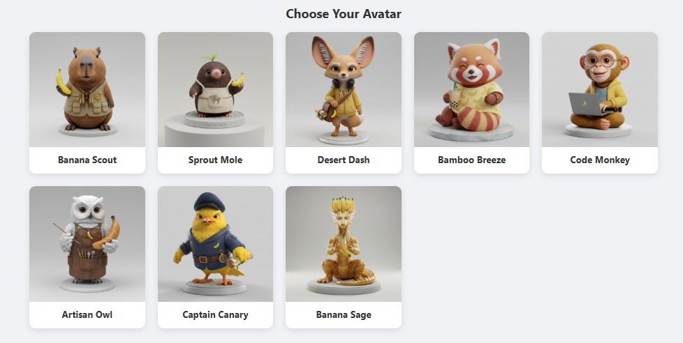

# Banana Level Up: AI Avatar Creation

An interactive web demo for AI-powered avatar creation. Pick from a cast of 3D collectible figurine characters, inspect them in a 360° viewer, or generate an entirely new one from a text description.

<!--  -->

**Live Demo**: [Play with Banana Level Up on GitHub Pages](https://seehiong.github.io/banana-levelup/)

The interesting parts, from an image-generation standpoint:

- **Consistent Character Rendering**: Maintaining a single character identity across multiple viewing angles.
- **Style Fusion**: Blending a text description with a consistent "3D collectible figurine" art direction, so newly generated avatars fit alongside the existing cast.
- **Automated Creative Workflows**: Node scripts that generate the full base-character set and their 360° rotations from prompts alone.

## ✨ Core Features

- **Interactive AI Assistant**: A built-in chat panel that acts as your personal guide to the Banana Level Up world, helping you learn about the characters.
- **Natural Language Avatar Generation**: Type `/generate <description>` in the chat to create a brand-new avatar from a text prompt — e.g. `/generate a cute cyberpunk cat hacker with neon green glasses holding a banana, rendered as a 3D photorealistic collectible figurine on a white base.`
- **Character Selection**: Choose from 8 unique base characters, each rendered as a high-quality, photorealistic 3D collectible figurine.
- **360° Viewer**: Inspect your chosen character from all angles using an interactive viewer. Rotate the model with your mouse (scroll, click-and-drag) or keyboard arrow keys.
- **Multiple Views**: Toggle between a 4-direction view (PNG) and a smoother 8-direction view (PNG + JPEG) for characters that have the complete image set.
- **Bring Your Own Key**: Choose between **Google Gemini** (`@google/genai`) and **OpenRouter** as your provider, with configurable chat and image models. Keys are stored only in your browser's local storage and never leave your machine except to call the provider directly.
- **Responsive Design**: A grid layout that adapts from mobile to desktop.

### 🚧 Roadmap

These are scaffolded in the codebase but not yet wired into the UI:

- **Targeted Local Edits**: Modify an existing avatar in place (e.g. "give him a golden banana sword", "add a glowing aura").
- **Visual Progression**: The XP/leveling model in `src/base_character.jsx` exists, but characters do not yet earn visual upgrades like badges or armor.

## 🐵 Base Character Descriptions

Each character reflects a specific age and user demographic with consistent artistic style and photorealistic 3D collectible figurine quality. The banana theme evolves from playful patches to sophisticated accessories, showing character progression.

#### Banana Scout (Explorer)
A curious and friendly capybara in a scout vest, holding a banana like a new discovery. Represents curiosity and first steps.

#### Sprout Mole (Gardener)
A shy mole with a banana leaf sprouting from its head, holding a prized banana. Represents growth and discovery.

#### Desert Dash (Fennec Fox)
A clever fennec fox with huge ears, a yellow hoodie, and a messenger bag. Represents a sharp and resourceful mind.

#### Bamboo Breeze (Red Panda)
A chill red panda enjoying a banana-flavored boba tea. Represents social connection and enjoying the moment.

#### Code Monkey (Tech Guru)
A clever capuchin monkey with glasses and a hoodie, expertly typing on a miniature laptop. Represents mastery of technology.

#### Artisan Owl (Creative Master)
A wise snowy owl in an artist's apron, holding a paintbrush. Represents artistic skill.

#### Captain Canary (Adventurer)
A brave canary in a captain's hat and aviator jacket, holding a treasure map. Represents leadership and adventure.

#### Banana Sage (Dragon)
A wise, ancient golden dragon with banana-shaped horns, guarding a mystical banana crystal. Represents the pinnacle of wisdom.

## 🛠️ Tech Stack

- **Frontend**: React 18 with Vite 7
- **AI/ML**: Google Gemini API (`@google/genai`), with optional OpenRouter support
- **Icons**: `lucide-react`
- **Storage**: `localforage` for client-side persistence
- **Image tooling**: `sharp` (build-time scripts), `gifshot`
- **Styling**: Plain CSS
- **Hosting**: GitHub Pages via GitHub Actions

## 🚀 Getting Started

### Prerequisites

- Node.js (v18 or higher)
- A [Google Gemini API key](https://aistudio.google.com/apikey) or an [OpenRouter API key](https://openrouter.ai/keys)

### Installation & Setup

1.  **Clone the repository:**
    ```bash
    git clone https://github.com/seehiong/banana-levelup.git
    cd banana-levelup
    ```

2.  **Install dependencies:**
    The base character images are already provided in the `public/` directory, so no generation is required to run the app.
    ```bash
    npm install
    ```

3.  **Run the development server:**
    ```bash
    npm run dev
    ```
    The application will be available at `http://localhost:5173`.

4.  **Add your API key in the app:**
    Click the AI Assistant chat bubble in the bottom-right corner, pick your provider (Google or OpenRouter), and paste your key. It is stored in your browser's local storage only — there is no backend and the key is never committed or uploaded anywhere.

### (Optional) Regenerating Character Art

The image-generation scripts run in Node and need a key on disk. Copy the example file and fill it in:

```bash
cp .env.example .env
```

```text
GEMINI_API_KEY="YOUR_GEMINI_API_KEY"
```

> `.env` is gitignored — never commit it.

Then generate the base characters first, followed by their rotations:

```bash
# 1. Base character images
npm run setup-basechar

# 2. 4-directional rotational views for ALL characters
npm run setup-rotations

# Or, generate rotations for a single character
npm run setup-rotations -- sprout-mole
```

**Note:** The 8-view JPEGs were added manually and are not produced by these scripts.

### Available Scripts

- `npm run dev`: Starts the Vite development server.
- `npm run build`: Builds the application for production.
- `npm run preview`: Serves the production build locally.
- `npm run setup-basechar`: Generates only the base character images (useful if you've already installed dependencies).
- `npm run setup-rotations`: Generates 360° rotational views for characters.

## 🚢 Deployment

Pushes to `main` are built and published to GitHub Pages by [.github/workflows/deploy.yml](.github/workflows/deploy.yml). The site is served from a subpath, which is why `vite.config.js` sets `base: '/banana-levelup/'` — change this if you fork under a different repository name.

No secrets are needed in CI: the app has no backend and users supply their own API key at runtime.

## 🔒 A Note on API Keys

This is a client-side-only demo. Your API key is held in browser local storage and sent directly from your browser to Google or OpenRouter. That is fine for a personal demo, but it means the key is visible to anything running in your browser — use a key with limited quota and revoke it when you're done.

## 📜 License

This project is licensed under the [MIT License](LICENSE).